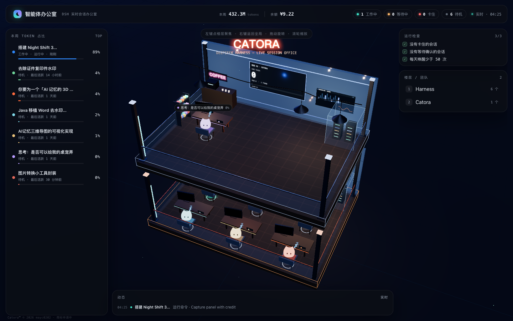
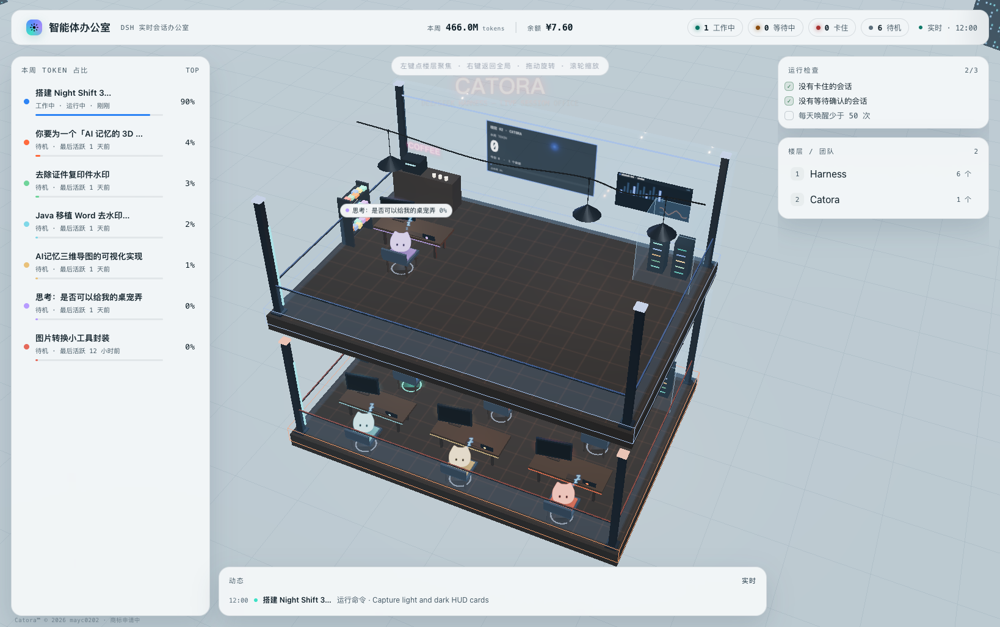
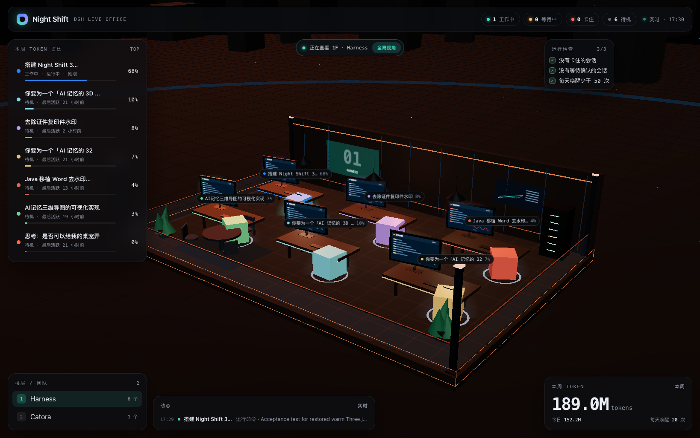
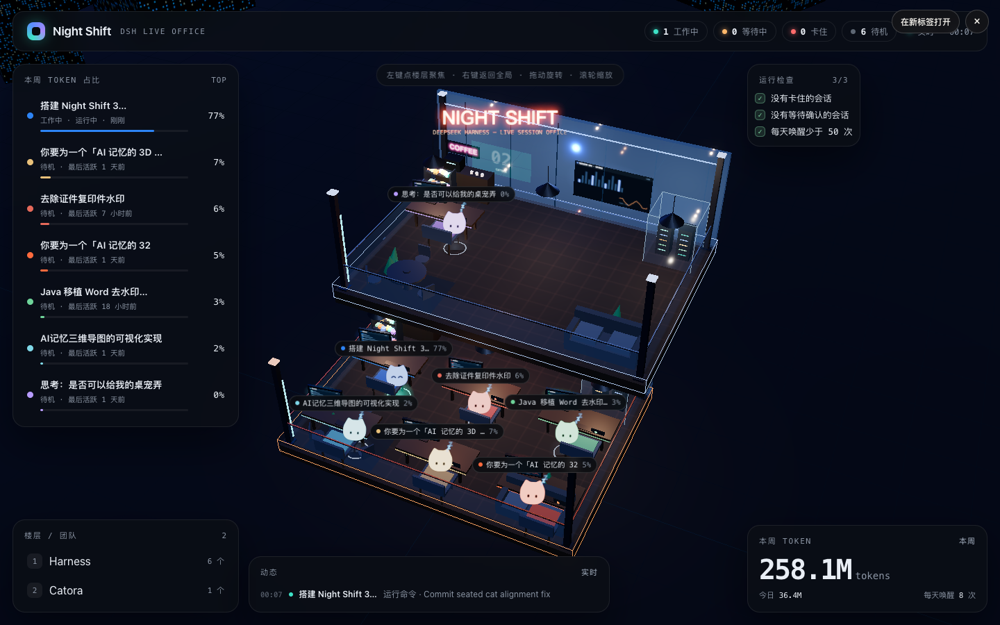

# Office · DSH 插件版

> 非官方第三方插件，与 DeepSeek 官方无隶属或背书关系。

把 DeepSeek Harness 的全部会话变成一间实时 3D 办公室：右下角一个猫头按钮，点开就是全屏面板。

这也是 **Catora** 产品在 DSH 里的第一块拼图：Catora 正式发布后，会把这套「会话可视化 + 知识工作流」抽离成 MCP 服务，让用户通过 DeepSeek Harness 直接使用 Catora 的笔记、思维导图、私人知识库与 RAG 检索能力。
3D 场景用 **Three.js** 自绘（楼层、工位、Agent 小人、霓虹灯牌、动态状态动画），不依赖第三方页面模板，也不依赖 ntfy 或常驻外部进程。







## 特性

- 🎨 **夜景 3D 办公室**：透视镜头、楼层按活跃工作区自动增加；每层有沙发、咖啡吧、大屏、玻璃机房、彩色货架；
- 🌃 **昼夜切换**：跟随系统时间自动切换（06:00–18:00 白天，其余夜晚），左上角月亮/太阳图标显示当前时段；场景灯光、天空、城市、霓虹与曝光平滑过渡；
- 🏙️ **写字楼夜景**：程序化高低错落的写字楼（亮窗/楼顶信标/霓虹竖条）；背墙为透明玻璃；
- 🔧 **机房 LED**：机柜指示灯持续闪烁；货架固定在楼层内；
- 📟 **工作区大屏**：每层墙面大屏显示该工作区（团队）的本周 TOKEN、今日 TOKEN、会话数和占比条，随轮询实时更新；
- 💳 **DeepSeek 余额卡**：读取本机 DSH 登录凭证，查询平台充值钱包余额与赠金（只展示币种/金额，token 不出本机进程）；
- 🖥️ **显示器状态**：休息/完成时黑屏待机；工作中显示代码编辑器（滚动行 + 光标）；工作超过 5 分钟或卡住时显示红色「HIGH LOAD / 执行任务时间过长」告警；
- 🐱 **猫猫 Agent（Catora 主题）**：用 catora-cat 的 logo / 表情差分 PNG 做成平面贴图立牌（Three.js Sprite），**永远面向相机**，颜色按 Agent 调色；空闲时用 sleepy 表情 + 飘「Z」睡觉，其他状态用 happy/surprised/dizzy/loved；猫咪用 GSAP 做上下浮动动画，座垫上带随浮动变化的软阴影；
- 🖼️ **自定义猫咪图片**：DSH 设置 →「Office」上传图片即可替换所有 Agent 头像（本地 localStorage 保存，不上传服务器）；
- 🎚️ **面板不透明度**：DSH 设置 →「Office」可调 HUD 卡片透明度（50%–95%），面板实时跟随；
- 😅 **状态表情**：正常工作猫猫大汗淋漓；工作超过 5 分钟进入红温，头顶乱线；待机改成两条小缝；
- 🏢 **双办公室 + MCP 链路**：主楼右侧 Annex 是教室布局：后方讲台，三席面朝讲台——通用工位、备考隔间、题库工位（浮动 OCR / 数据库 / 试卷全息图标）；虚线 MCP 链路带流动光点，两端蓝色 ✕ 表示暂未接通；

- 🏢 **3D 实时办公室**：Three.js 自绘的错层办公室——每层有工位、显示器、会议桌、白板、服务器机柜、玻璃护栏和吊灯；每个会话是一个简洁的立方体 Agent（按状态做呼吸/浮动脉冲，工作/等待/卡住/待机各有反馈）；
- 🖱️ **楼层聚焦**：左键点任意楼层（或左侧楼层列表）→ 只显示并看清这一层；右键 /「全局视角」按钮 / `Esc` 回到整栋楼的全局视角；
- 📡 **真实数据**：状态、今日执行次数、本周/今日 **Token 用量** 全部来自本机会话日志，数字不编造；
- 🖱️ **可交互**：拖动旋转、滚轮缩放、点击立方体或名字看详情、详情卡 ×/Esc 关闭；
- 🧩 **原生插件**：bundle 插件，装完即用（宿主路由 + 浏览器半侧悬浮按钮），无外部依赖；
- 🔒 **默认只读本机**：只读 `$DSH_HOME/sessions`；只有你在设置里主动开启「本地天气」后，才会把坐标发给 Open-Meteo 获取天气，位置本身只保存在本地。
- 🏗️ **搭建入场**：每次打开面板先播放 0→1 的建造过程，楼层、工位、猫猫和 MCP 链路逐步落位。
- 🌦️ **本地天气**：设置里允许定位后，按所在城市显示晴/阴云/雨/雪/风；不开定位则不启用天气效果。

## 安装

### 方式 A：从 npm 安装（推荐）

包名 `dsh-agent-office` 发布后，在 DSH 插件页搜索 **dsh-agent-office**，或命令行：

```bash
DSH="/Applications/DeepSeek Harness.app/Contents/Resources/runtime/cli/bin/dsh"
"$DSH" plugin --profile desktop add dsh-agent-office
```

### 方式 B：从 GitHub 安装

DSH 侧边栏 → **插件** → 安装组合包，填：

```
github:mayc0202/dsh-agent-office
```

或命令行：

```bash
DSH="/Applications/DeepSeek Harness.app/Contents/Resources/runtime/cli/bin/dsh"
"$DSH" plugin --profile desktop add github:mayc0202/dsh-agent-office
```

安装后在「插件」页勾选 **Office**（或把 `dsh-agent-office` 追加到
`~/.dsh/profiles/desktop/package.json` 的 `dsh.profile.bundles`），重启 DSH 生效。

### 方式 C：本地目录

```bash
git clone https://github.com/mayc0202/dsh-agent-office
"$DSH" plugin --profile desktop add link:"$(pwd)/dsh-agent-office"
```

### 安装后

- 右下角出现猫头按钮，点开全屏面板，`Esc` 关闭；
- 或直接访问 `http://127.0.0.1:<DSH端口>/agent-office/`。

## 先预览（不安装）

```bash
npm install          # 安装 three / esbuild（仅构建/预览需要）
node dev/dev-server.mjs
# 打开 http://127.0.0.1:8899/agent-office/
```

`dev/dev-server.mjs` 只起一个最小 HTTP 服务（同一份面板 + 同款 API），用于验证页面与数据。



## 工作原理

| 半侧 | 文件 | 作用 |
| --- | --- | --- |
| 宿主 | `lib/index.js` | 在 DSH 的 Web 服务器上挂 `GET /agent-office/`（页面）和 `GET /agent-office/api/state`（数据） |
| 数据 | `lib/state.js` | 读 `~/.dsh/sessions/<workspace>/<session>/session.v4.jsonl.zstd`（多帧 zstd 逐帧解压，按 mtime 缓存）；从 `turn/start|end`、`tool/call`、`assistant/message.usage`、`approval/asked|decided`、`ask_user_question` 推导状态与用量 |
| 客户端 | `lib/client.js` | 右下角「Catora」悬浮按钮 + 全屏 iframe 覆盖层，可「在新标签打开」 |
| 3D 页面 | `lib/panel.html` | 单文件构建产物（Three.js 场景 + HUD），同源轮询 API |
| 页面源码 | `panel-src/` + `panel/build.mjs` | 可读源码 + esbuild 打包脚本 |

数据口径：

- 名册：最近 `activeWindowHours`（默认 24 小时）内活跃的会话，最多 `maxAgents`（默认 7）个，名字取会话标题；
- 楼层：会话所在工作区（`Harness` / `Catora` / 其他）；
- 今日执行：当天 `turn/start` 次数；
- 本周占比：该会话本周（周一至今）Token 占全部展示会话的百分比；
- 今日/本周 Token：`assistant/message` 里 `usage.totalTokens` 的真实累计。

## 配置

在 profile 的 `cordis.patch.yml` 里加 `config`（或改本包 patch）：

```yaml
- insert:
    - id: agent-office
      name: dsh-agent-office
      config:
        maxAgents: 7            # 名册最多显示几个会话
        activeWindowHours: 24   # 只统计最近多少小时内活跃的会话
        sessionsDir: null       # 默认 $DSH_HOME/sessions
```

## 开发构建

```bash
npm install
node panel/build.mjs     # panel-src/ → lib/panel.html（单文件）
node dev/dev-server.mjs  # 本地预览
node --check lib/index.js lib/state.js lib/client.js
```

## 交互

| 操作 | 结果 |
| --- | --- |
| 左键点楼层 / 左侧「楼层」 | 聚焦该层，只显示这一层 |
| 右键 / 顶栏「全局视角」/ `Esc` | 回到整栋楼全局视角 |
| 拖动 / 滚轮 | 旋转 / 缩放（聚焦时也可以） |
| 点机器人或名字标签 / 左侧榜单 | 打开该会话详情卡 |
| `Esc` | 有详情卡时先关卡片，再按一次回全局 |

## 已知限制

- 只读本机会话日志；日志是追加写的多帧 zstd，正在写入时最后一帧可能不完整（会跳过不完整部分）；
- 只展示最近活跃的会话，更早的会话不会进入名册；
- 3D 场景按最多 4 个团队楼层设计。

## 许可

MIT（见 `LICENSE`）。打包产物内联了 Three.js（MIT，© three.js authors），见 `NOTICE`。

---

## English

**Agent Office** is a DSH plugin that turns every DeepSeek Harness session into a live 3D office built with Three.js.

- Install: `dsh plugin --profile desktop add github:mayc0202/dsh-agent-office`, enable **Agent Office** in the plugin manager, restart DSH. A floating cat-head button appears in the bottom-right corner; clicking it opens `/agent-office/`.
- Data: reads `$DSH_HOME/sessions/**/session.v4.jsonl.zstd` (read-only, no network). Status, turn counts and token usage are derived from `turn/*`, `tool/call`, `assistant/message.usage` and approval events.
- Preview: `npm install && node dev/dev-server.mjs` → http://127.0.0.1:8899/agent-office/
- License: MIT; bundled Three.js is MIT (see `NOTICE`).


## 版权与声明

- 本插件是**非官方第三方插件**，与 DeepSeek 官方无隶属或背书关系；`DeepSeek` / `DSH` 仅用于说明兼容对象。
- 插件代码（宿主、数据层、客户端、3D 面板源码）为本仓库作者原创，按 MIT 授权。
- **Catora 角色形象、猫咪表情素材和 “Catora” 名称/标识均为作者 mayc0202 原创并所有**，商标注册申请已提交、审核中（™）。这些素材随插件分发，但不纳入 MIT 代码许可；未经书面许可，不得单独抽取再分发或用于其他产品。详见 `NOTICE`。


## 路线

- **当前**：3D 智能体办公室，实时展示 DSH 会话状态、Token 用量与团队楼层。
- **Catora 发布后**：抽离为 MCP 服务，接入 Catora 的笔记、思维导图、私人知识库与 RAG 检索。
- **目标**：在 DeepSeek Harness 内完成「观察 Agent → 沉淀知识 → 检索复用」的闭环。
